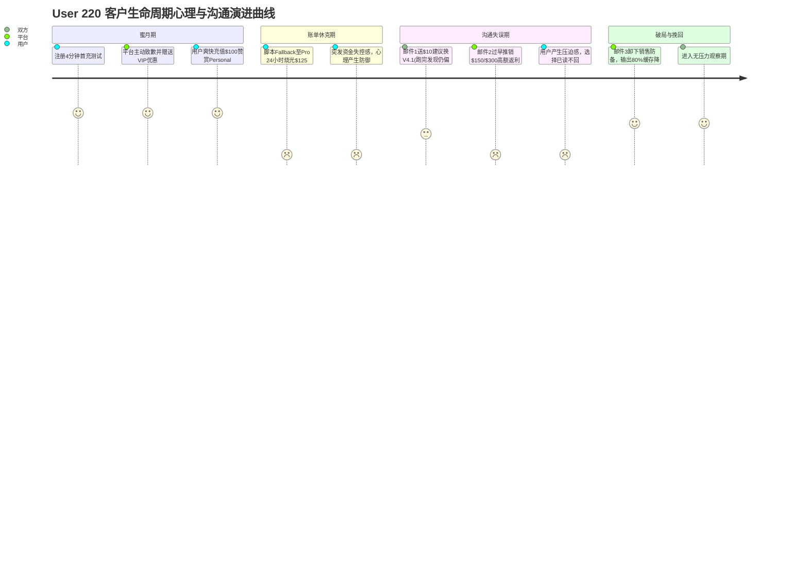

# APIVALE 核心大客户（User 220: Aliaksandr Harbunou）全生命周期追踪与复盘教训

> **记录时间**：2026-09-16  
> **客户画像**：平台历史充值与调用量最高（Top 1 Whale 客户），累计实付 $289.00，实际消耗 $307.24（1.53 亿 tokens），8,020 次长文本 API 调用。  
> **核心模型**：`DS/deepseek-v4-flash-vision-exp`、`deepseek-v4-pro`（单次请求 Prompt 达 160K~170K tokens）。  
> **当前状态**：2026-09-16 已发送第三封“技术架构降本与预算熔断保护（无充值压力）”破局破冰邮件，进入 T+1 观测期。

---

## 一、 客户档案与价值总览

| 维度 | 数据 / 事实记录 |
| :--- | :--- |
| **用户 ID / 用户名** | `220` / `google_220` |
| **姓名 / 邮箱** | **Aliaksandr Harbunou (Alex)** / `onekit@gmail.com` |
| **注册渠道 / 时间** | Google OAuth / 2026-09-02 07:21:02 |
| **IP / 地区 / 设备** | `185.4.74.13`（欧洲 / 东欧独立开发者），Windows PC |
| **账号权限分组** | **`vip`** 专属高质量通道组 |
| **充值历史明细** | 累计充值 **$289.00**（共 11 笔订单，成功 10 笔）： • 09-02: $10 (首充) + $20 (追加) • 09-03: $20 • 09-04: $20 + $49 (Pending 后立重充 $49 成功) • 09-05: $20 • 09-08: **$100.00** (实付 $97) • 09-09: $10 + $10 + $10 |
| **平台累计消耗** | **$307.24**（消耗 Quota 153,613,475，总请求 8,020 次） |
| **最后余额状态** | **$0.0173**（最后一次高并发批量调用消耗 23,795 quota，因余额不足自然停止） |

---

## 二、 4 轮完整沟通过程演进全记录

### 【第 1 阶段：蜜月期与极高信任】（2026-09-08 ~ 09-09）
* **触达动作**：平台发现该客户在处理 120k+ 长文本模型，且前期遇到过一次 PayPal glitch，管理员主动发送首封 VIP 关怀邮件（提供充 $100 赠 $25 优惠）。
* **客户反馈**：Alex 极度感动，回复道：  
  > *"Thank you for such a personal approach. Yes, I have just added 100 USD to my balance."*  
  并主动附上控制台截图，展示账户已有 $100 余额。
* **当时客户心理**：在此之前跑了 5,000 次才花 $40 多美金，他认为 APIVALE 极其高性价比，认为这 $125 足够支撑 1~2 个月的大规模研发。

### 【第 2 阶段：账单休克与失控感】（2026-09-09 ~ 09-10）
* **突发事件**：用户脚本遇到上游偶发重试，本地代码配置的兜底逻辑自动切换到了旗舰模型 `deepseek-v4-pro`（单价 $1.17 / 1M tokens）。
* **后果**：在密集吞吐 72M tokens 过程中，**仅仅 24 小时不到，$125 美元全部烧光归零**。
* **客户心理冲击（Bill Shock）**：从“每次调用 0.8 美分”突变到“一天蒸发 100 美元”，巨大的吞金黑洞感让任何工程负责人都陷入严重的**资金失控恐慌**。

### 【第 3 阶段：跟踪动作与沟通失误复盘】（2026-09-11）
* **邮件 1（Sep 11 06:59）**：
  * **内容**：客观拆解切换到 Pro 的原因，赠送 $10 测试金，建议改用新上线的 `deepseek-v4.1-flash`。
  * **执行结果**：Alex 实际接受了 $10 测试金，并于当天 02:18~04:12 UTC 跑了 389 次批处理。
  * **潜在挫败**：因为他的单次 Prompt 高达 **168K tokens**，389 次请求依然花光了 $10.03（单次仍需 $0.026）。Alex 意识到：即使换了模型，整个项目的 Token 量级依然会让他承受不起。
* **邮件 2（Sep 11 下午跟进）——【关键失误点】**：
  * **内容**：汇报了 389 次成功数据后，直接抛出 *“Infrastructure Match Grant: 充 $150 送 $50 / 充 $300 送 $120”*。
  * **失误剖析**：
    1. **门槛骤然拉高**：用户心理正在为几百刀的预算上限焦虑，平台却反向要求 $150~$300 起充；
    2. **角色变形**：从最初受用户赞赏的 *“Personal Approach”* 蜕变成了 *“急迫促销的销售员”*；
    3. **未触及本质恐惧**：没有给客户提供“万一脚本再遇到循环，如何避免被扣光”的硬性防护机制。
  * **结果**：Alex 产生防御心理，彻底停止回复（Ghosting 沉默 5 天）。

### 【第 4 阶段：破局挽回邮件发出】（2026-09-16 08:20）
* **邮件主题**：`Alex, an engineering note on reducing your 168k prompt costs by 80% (No top-up pitch)`
* **核心策略**：
  1. **主动撕掉销售标签**：明确说明“纯工程探讨，零充值推销，无任何压力”；
  2. **直击大象（Context Fatigue & Cost Anxiety）**：共情其“换作是我也会立刻暂停流水线”；
  3. **硬熔断保护机制（Hard Circuit Breaker）**：承诺可为 API Key 设定每日最高消费上限（如 $10/天），杜绝任何失控；
  4. **提示词缓存（Context Caching 架构解法）**：指出 168K 静态上下文通过缓存可享受 $0.01 / 1M 极低成本，把单次费用从 $0.026 骤降至 $0.004（让 $10 能跑 2,500 次）；
  5. **给予长期空间**：VIP 永久保留，无时间限制。

---

## 三、 核心经验教训与避坑指南

### 1. 警惕高并发客户的“账单休克（Bill Shock）”
* **教训**：当一个客户账户在超短时间内（如 24h 内）消费金额剧增 5~10 倍时，系统或客服**绝不能只当作“大额营收”来庆祝**。
* **规则**：大额异常加速消耗往往伴随着客户的失控惊慌。此时客户第一需求不是“买更多”，而是**“为什么这么贵？能不能刹住车？”**。

### 2. 避免“在客户犹豫时推销更高客单价”
* **教训**：当客户对 $100 的去向心存疑虑时，千万不要推荐 $150 或 $300 的大额套餐，这会彻底破坏前期建立的信任。
* **规则**：客户犹豫期，唯一能推的是**“更小的步长（$10~$20 测试金）”**与**“更高的能效比（降本方案）”**。

### 3. 技术降本方案永远高于纯商务返利
* **教训**：对于专业开发者，给“充 100 送 25”远不如教他“如何用 Prefix Caching 把 168K tokens 的成本砍掉 80%”。
* **规则**：以系统架构师 / 资深顾问的身份与海外技术客户对话，帮客户省钱的平台，客户才会长期把钱留在这里。

---

## 四、 后续追踪与观测计划

* **T+1 监控（2026-09-17）**：
  * 监控邮箱 `onekit@gmail.com` 是否有礼貌性回复；
  * 查询 PostgreSQL `logs` 表，关注 IP `185.4.74.13` 是否有重新访问控制台或尝试轻量请求。
* **T+3 节点（2026-09-19）**：
  * 若客户回复并希望配置限额或缓存，由技术团队在后台为其定制 Token 级别配额策略；
  * 若客户依然沉默，保持克制，不再频繁发送邮件打扰，保留其 VIP 分组与账号，等待其新项目周期自然唤醒。
