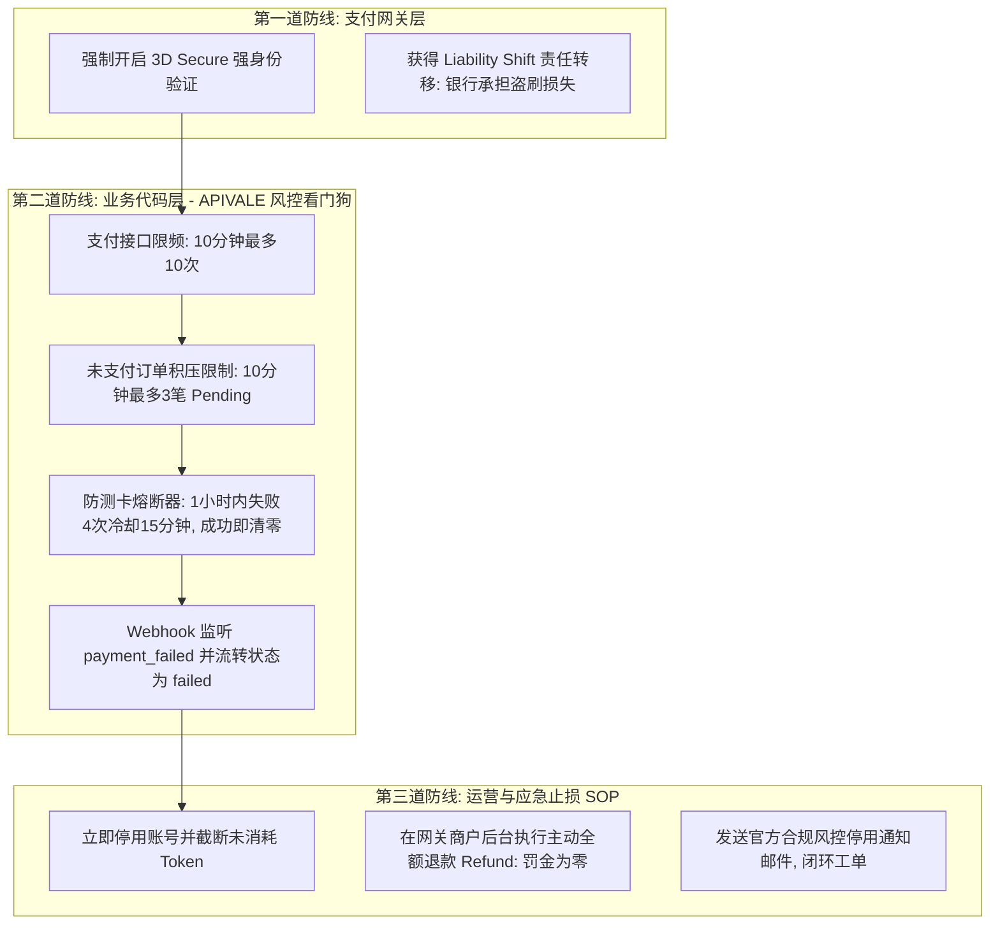

# 跨境支付防盗刷、防测卡与风控止损复用手册 (Payment Anti-Fraud & Risk Playbook)

> **适用场景**：任何面向海外用户提供在线充值/订阅的 SaaS、AI API Gateway、跨境独立站等项目。  
> **核心目标**：阻断信用卡盗刷测卡（Carding）黑产、消除银行拒付（Chargeback）高额罚款与封店风险、保障真实用户付费转化率。

---

## 一、 海外信用卡黑产盗刷典型攻击特征 (Anatomy of Attack)

在用户 `284` 的真实案例中，攻击者表现出极具代表性的黑产作业链条：


### 致命陷阱（不做风控的代价）：
1. **“客户用了服务就不能退”是致命误区**：在国际信用卡（Visa/Mastercard）规则中，持卡人根本没有授权该交易，银行一律判持卡人胜诉并强制扣回资金。
2. **争议手续费（Dispute Fee）反噬**：一旦被动触发争议，每笔将产生 **$15 ~ $25** 的高额罚金；若商户争议率超过 0.9%，商户账户会被冻结并处以数千美元罚款。

---

## 二、 三维立体风控体系架构 (Three-Tier Defense)



---

## 三、 核心代码架构实现标准 (Implementation Reference)

### 1. 支付风控熔断器平衡算法（已在 `service/payment_risk_guard.go` 落地）
* **平衡原则**：严防黑产测卡自动化，同时兼顾真实用户的容错空间（输错卡号、网银App临时开通境外支付、换备用卡）。
* **核心参数矩阵**：
  * `PaymentMaxFailuresPerHour = 4`：1 小时内允许失败 3 次，第 4 次触发熔断。
  * `PaymentCooldownMinutes = 15`：触发熔断后冷却 15 分钟（足以破坏自动化测卡脚本，又允许正常用户开通网银后重试）。
  * `PaymentMaxPendingOrders = 3`：限制 10 分钟内未完成订单最多 3 笔，防止刷结账链接。
  * **成功即清零**：任何一笔支付收到网关 `succeeded` 回调，立即清空失败计数与冷却标记。

### 2. 双模存储设计 (Redis + 内存原子回退)
* 生产环境有 Redis 时，使用带 TTL 的 Key（`risk:pay:fail:<id>` 和 `risk:pay:cooldown:<id>`）。
* 纯单机/本地无 Redis 时，使用带过期时间检查的 `sync.Map`，保证系统任何环境都能开箱即用。

### 3. Webhook 闭环设计 (不能静默忽略失败)
* 必须在 Webhook 中捕获 `payment_failed` 事件。
* 将订单在本地 DB 中置为 `failed` 状态，并主动调用 `RecordPaymentFailure` 累加风控计数。

---

## 四、 应急止损操作标准流程 (Emergency SOP)

当支付网关或监控系统提示某账户涉嫌欺诈/盗刷时，必须严格按以下 4 步在 **30 分钟内** 完成止损：

### 步骤 1：立即封停账号并收回剩余 Quota
* 在管理后台将该用户状态置为 **“已禁用”**，将余额清零。
* **目的**：立刻掐断其自动化调用脚本，保住未消耗的余额，防止上游 API 成本继续增加。

### 步骤 2：在支付网关后台执行【主动全额退款 (Refund)】
* **核心认知**：**主动退款（Refund）≠ 被动拒付（Chargeback）**。
* 在网关后台对成功交易点击 Refund，备注填写：`Suspected fraud / Multi-card testing risk prevention`。
* **收益**：主动退款不会产生每笔 $15~$25 的争议罚款，不计入商户败诉拒付率，彻底保全商户通道信誉。

### 步骤 3：与支付网关客服官方报备
* 在服务群告知网关客服已主动封禁与全额退款，展现商户高度合规自律的风控姿态。

### 步骤 4：发送标准风控停用通知邮件 (邮件模板)
* 发送中立、严谨、符合国际反欺诈法规的正式英文邮件（模板见下节），关闭纠纷并保留合法合规举证渠道。

---

## 五、 常用模板与沟通物料 (Ready-to-Use Templates)

### 1. 官方风控停用与退款邮件通知模板 (中英双语)
* **主题 (Subject)**: `Account Suspended due to Security Violation - [Brand Name] Support`
* **正文**:
```text
Hi,

During our regular security and compliance audit, our automated fraud detection system and payment processor flagged your account for severe payment violations, specifically involving rapid attempts with multiple different credit card credentials.

In accordance with international payment security regulations and anti-carding policies:
1. Your account and API access have been permanently suspended.
2. Your previous successful transactions have been fully refunded back to the original payment cards. Please allow 3-7 business days for the credit to reflect on the respective card statements.

If you believe this action was taken in error and you are the legitimate authorized holder of all cards used, you may submit government-issued identification and bank statements for each card for manual review.

[Brand Name] Security Team  
https://[your-domain].com
```

### 2. 向支付网关申请开启 3DS 强验证话术
```text
客服您好，为了从源头杜绝海外信用卡盗刷与卡组织争议风险，请帮我们在网关后台为信用卡通道开启【3D Secure（3DS / 3DS2）强校验规则】（尤其是针对单笔 $20 以上交易或高风险地区卡强制触发短信/App动态码验证）。这样即便发生盗刷也能实现责任转移（Liability Shift）至发卡行，保障双方账户安全，谢谢！
```
